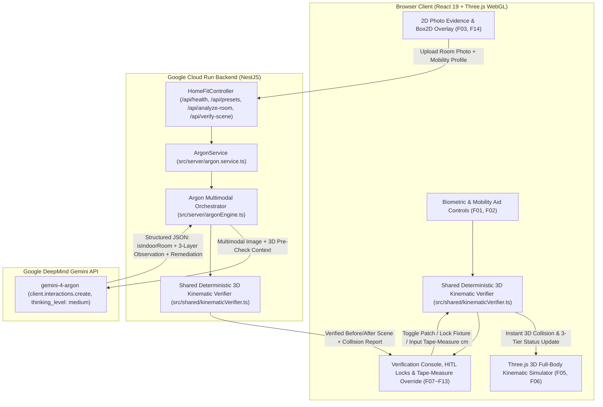

# Technical Requirements Document (TRD v1.0) — HomeFit 3D (Pre-Visit Home Safety Studio)

- **Date:** October 16, 2026
- **Companion Spec:** [docs/PRD.md](./PRD.md)
- **Track:** Track 3 — Google AI for Social Good
- **Core AI Model:** `gemini-4-argon` via `@google/genai` Interactions API (`client.interactions.create`)

---

## 1. System Architecture & Technology Stack

### 1.1 Technology Stack

| Layer | Technology | Version / Spec | Rationale |
| :--- | :--- | :--- | :--- |
| **AI Spatial Reasoning Engine** | **Gemini 4 Argon (`gemini-4-argon`)** | `@google/genai` (`^2.29.1`), Interactions API | Multimodal 3-layer (`Floor`, `Mid`, `Overhead`) hazard extraction, causal chain reasoning (`thinking_level: "medium"`), and constraint-aware remediation synthesis. |
| **Frontend UI** | **React 19 + TypeScript + Tailwind CSS v4** | React `19.1.0`, Vite `6.3.1` | Responsive 3-pane synchronized workspace (2D Photo AR Evidence + 3D Kinematic Viewport + Verification & HITL Console) with contextual hover tooltips ([`HoverTooltip.tsx`](../src/client/components/HoverTooltip.tsx)). |
| **3D WebGL Rendering** | **Three.js (`three`)** | `^0.175.0` | Real-time procedural 3D architectural fixtures ([`architectural3DBuilder.ts`](../src/client/components/architectural3DBuilder.ts)), 3 elevation slice planes, 4 articulated mobility avatars, 3D `CatmullRomCurve3` head-pitch trajectory tube, and pulsing collision spheres. |
| **Deterministic Physics Verifier** | **Isomorphic TypeScript Kinematic Engine** ([`src/shared/kinematicVerifier.ts`](../src/shared/kinematicVerifier.ts)) | Shared pure TypeScript module (Client + Server) | Guarantees hallucination-free geometric collision checks, instant slider/tape-measure re-verification (0ms latency), and deterministic closed-loop pass/fail gating. |
| **Backend Framework** | **NestJS (`@nestjs/core`, `@nestjs/common`, `@nestjs/platform-express`)** | NestJS `11.x`, Node `22` | Modular Dependency Injection architecture ([`AppModule`](../src/server/app.module.ts), [`HomeFitController`](../src/server/homefit.controller.ts), [`ArgonService`](../src/server/argon.service.ts)), server-side API key security, and static SPA serving. |
| **Cloud Deployment** | **Google Cloud Run (Docker)** | `PORT=8080`, Single Container | Stateless, auto-scaling container deployment on Google Cloud Run (`asia-northeast3`). |

### 1.2 System Data Flow & Closed-Loop Verification Architecture



---

## 2. Requirements Traceability Matrix (`F01` ~ `F14`)

| PRD ID | Requirement | Primary Module / Symbol | Verification Method |
| :--- | :--- | :--- | :--- |
| **F01** | Mobility Aid & Biometric Sliders | [`MOBILITY_PROFILES`](../src/shared/presetScenes.ts), [`IndoorMobilityProfile`](../src/shared/types.ts) | Switching across 4 mobility aids (`Crutches`, `Wheelchair`, `Walker`, `Cane`) or adjusting height (`148–188cm`), forward head pitch (`12–42cm`), or stance width immediately updates 3D head-strike clearance and collision count. |
| **F02** | Real-Case Presets & Custom Upload | [`PRESET_SCENES`](../src/shared/presetScenes.ts), [`HomeFitController.analyzeRoom`](../src/server/homefit.controller.ts) | Switching between Preset 1 (Parent's Bathroom) and Preset 2 (Corridor) or uploading a room photo updates both 2D and 3D views. |
| **F03** | 3-Layer Spatial & Material Extraction | [`analyzeRoomWithArgon`](../src/server/argonEngine.ts), [`SceneObject3D`](../src/shared/types.ts) | Objects carry normalized `box2d: [ymin, xmin, ymax, xmax]`, 3D `position`/`dimensions`, `layer` (`floor`/`mid`/`overhead`), and `materialHazard`. |
| **F04** | Epistemic Blind-Spot Separation | [`UnverifiedZone`](../src/shared/types.ts), [`verifyRoomScene3D`](../src/shared/kinematicVerifier.ts) | Unverified non-visual factors (e.g., wet tile friction, wall stud anchor strength) prevent `VERIFIED_SAFE_PASS` until checked on site. |
| **F05** | Three.js 3D Volumetric Viewport & AR Overlay | [`RoomCanvas3D.tsx`](../src/client/components/RoomCanvas3D.tsx), [`PhotoAROverlay.tsx`](../src/client/components/PhotoAROverlay.tsx), [`architectural3DBuilder.ts`](../src/client/components/architectural3DBuilder.ts) | Renders 3D room bounds, procedural 3D furniture/fixtures, 2D AR bounding overlays, tempered-glass danger zone, and pulsing collision spheres. |
| **F06** | Articulated Avatar & Head-Pitch Arc | [`RoomCanvas3D.tsx`](../src/client/components/RoomCanvas3D.tsx), [`architectural3DBuilder.ts`](../src/client/components/architectural3DBuilder.ts) | Renders articulated 3D human with crutches, manual wheelchair, folding walker, or cane + grab bar and `CatmullRomCurve3` 3D head trajectory arc. |
| **F07** | Deterministic 3-Layer Physics Engine | [`verifyRoomScene3D`](../src/shared/kinematicVerifier.ts) | Evaluates 6 hazard rules across `floor`, `mid`, and `overhead` layers. |
| **F08** | On-Site Tape-Measure Override | [`applyDimensionOverridesToObjects`](../src/shared/kinematicVerifier.ts) | Editing object dimensions promotes `visual_estimate` → `user_measured` and recalculates 3D collisions immediately. |
| **F09** | Caregiver Fixture Locking (HITL) | [`applyUserLocksToRemediation`](../src/shared/kinematicVerifier.ts) | Locking an overhead cabinet applies non-destructive film + bumper guard adaptation; locking a corridor obstacle retains the pinch warning. |
| **F10** | Autonomous 3D Remediation Patch | [`RoomSceneData.afterObjects`](../src/shared/types.ts), [`argonEngine.ts`](../src/server/argonEngine.ts) | Toggling `BEFORE` ↔ `AFTER` transitions 3D objects and trajectories to the patched layout. |
| **F11** | Evidence Card ↔ 3D Viewport Sync | [`App.tsx`](../src/client/App.tsx) | Selecting a hazard jumps the 3D avatar to the colliding waypoint and highlights the target object. |
| **F12** | 3-Tier Epistemic Status Machine | [`SimulationVerificationResult.overallStatus`](../src/shared/types.ts) | Strictly outputs `FAIL_CRITICAL_HAZARDS` (`Incompatible`), `NEEDS_ON_SITE_CHECK` (`Needs checking`), or `VERIFIED_SAFE_PASS` (`Meets checked conditions`). |
| **F13** | Welfare Subsidy & Action Checklist | [`RemediationActionItem`](../src/shared/types.ts) | Categorizes actions into `IMMEDIATE_ZERO_COST`, `WELFARE_EQUIPMENT`, and `HOME_MODIFICATION`. |
| **F14** | Non-Indoor Photo Guardrail | [`RoomSceneData.isIndoorRoom`](../src/shared/types.ts), [`verifyRoomScene3D`](../src/shared/kinematicVerifier.ts) | Non-indoor uploads force `NEEDS_ON_SITE_CHECK` and surface `invalidPhotoReason`. |

---

## 3. 3D Coordinate System & Kinematic Verification Mathematics

### 3.1 Coordinate System Convention (`Three.js` Y-Up Metric Space)
- **Units:** Meters (`m`) for 3D scene coordinates (`position`, `dimensions`) and Centimeters (`cm`) for biometric clearances and UI readouts (`1m = 100cm`).
- **Axes:**
  - `X-axis`: Left (`-width/2`) to Right (`+width/2`)
  - `Y-axis`: Vertical elevation above floor (`0.0m` = floor surface, `+height` = ceiling)
  - `Z-axis`: Back wall (`-depth/2`) to Front entrance (`+depth/2`)

### 3.2 Deterministic 3-Layer Kinematic Rules ([`src/shared/kinematicVerifier.ts`](../src/shared/kinematicVerifier.ts))

1. **Floor Layer (`0–30cm`) — Door Threshold Lip (`THRESHOLD_TRIP_OR_BLOCK`):**
   $$H_{\text{threshold\_cm}} > H_{\text{max\_allowed\_cm}} \implies \text{Hazard Flagged}$$
   - Manual Wheelchair limit: `1.5cm` (prevents front caster jam)
   - Bilateral Crutches limit: `2.0cm` (prevents crutch-tip/toe catch)

2. **Floor Layer (`0–30cm`) — Floor Clutter Stance Block (`FLOOR_CLUTTER_STANCE_BLOCK`):**
   - Computes effective usable floor stance width $W_{\text{usable\_cm}}$ around floor containers (`floor_clutter`).
   - If $W_{\text{usable\_cm}} < W_{\text{min\_passage\_cm}}$ (`68cm` crutches / `78cm` wheelchair), flags a `CRITICAL` hazard and adds a lateral torso shift $\Delta X_{\text{clutter}} = +0.14\text{m}$ toward the adjacent wall during sit-to-stand transfers.

3. **Mid Layer (`30–130cm`) — Corridor Pinch & 360° Turning Cylinder (`PASSAGE_PINCH_COLLISION`, `TURNING_RADIUS_COLLISION`):**
   - Evaluates horizontal X-gap between opposing mid-layer furniture with overlapping Z-intervals:
     $$G_{\text{gap\_cm}} = (X_{\text{right\_inner}} - X_{\text{left\_inner}}) \times 100 < W_{\text{min\_passage\_cm}} \implies \text{CRITICAL}$$
   - Evaluates available 360° pivot cylinder diameter against `profile.turningRadiusCm` (`85cm` crutches / `140cm` wheelchair).

4. **Overhead Layer (`130–195cm`) — Sit-to-Stand Head-Strike Envelope (`OVERHEAD_GLASS_HEAD_STRIKE`):**
   - Models the resident's standing head top $Y_{\text{head}} = \frac{\text{userHeightCm}}{100}$ and forward head-lean pitch $\Delta X_{\text{pitch}} = \frac{\text{sitToStandForwardPitchCm}}{100}$ during toilet/chair rising (`sit_to_stand_lean`):
     $$C_{\text{head\_cm}} = \left(|X_{\text{cabinet\_inner}}| - (\Delta X_{\text{pitch}} + \Delta X_{\text{clutter}})\right) \times 100$$
   - When $Y_{\text{head}} > Y_{\text{cabinet\_bottom}} + 0.04\text{m}$ and $C_{\text{head\_cm}} < 15\text{cm}$, flags a `CRITICAL` head-strike collision (negative $C_{\text{head\_cm}}$ indicates direct volumetric penetration into the tempered-glass cabinet).

5. **Overhead Layer (`130–195cm`) — One-Handed Crutch Release (`HIGH_REACH_CRUTCH_RELEASE`):**
   - If overhead storage center $Y_{\text{cab\_cm}} > \text{maxSafeReachHeightCm}$ (`135cm` for crutches) and no waist-level shelf (`Y ≈ 98cm`) is present, flags a `CRITICAL` balance loss hazard.

---

## 4. Gemini 4 Argon (`gemini-4-argon`) Integration Specification

Implemented in [`src/server/argonEngine.ts`](../src/server/argonEngine.ts):

```typescript
const interaction: any = await client.interactions.create({
  model: 'gemini-4-argon',
  input: inputContent,
  store: false,
  generation_config: {
    thinking_level: 'medium',
    thinking_summaries: 'auto',
  },
  response_mime_type: 'application/json',
});
```

- **Strict Compliance:** Uses `@google/genai` (`^2.29.1`) `client.interactions.create` exclusively. Does **not** call legacy `generateContent` and does **not** pass `temperature`, `top_p`, or `top_k`.
- **Reasoning Extraction:** Reads `thought` summaries from `interaction.steps` / `interaction.outputs` and structured JSON from `interaction.output_text`.

---

## 5. NestJS API Specification (`src/server/`)

- **Entrypoint:** [`src/server/index.ts`](../src/server/index.ts)
- **Module:** [`src/server/app.module.ts`](../src/server/app.module.ts)
- **Controller:** [`src/server/homefit.controller.ts`](../src/server/homefit.controller.ts)
- **Service:** [`src/server/argon.service.ts`](../src/server/argon.service.ts)

| Endpoint | Handler | Description |
| :--- | :--- | :--- |
| `GET /api/health` | `HomeFitController.getHealth()` | Returns server health, `framework: "NestJS"`, `model: "gemini-4-argon"`, and `liveApiConfigured` status. |
| `GET /api/presets` | `HomeFitController.getPresets()` | Returns `MOBILITY_PROFILES` and `PRESET_SCENES`. |
| `POST /api/analyze-room` | `HomeFitController.analyzeRoom()` | Analyzes a preset or custom uploaded room photo with `gemini-4-argon` and runs deterministic 3D verification on both `BEFORE` and `AFTER` states. |
| `POST /api/verify-scene` | `HomeFitController.verifyScene()` | Applies caregiver `lockedObjectIds`, `dimensionOverrides` (tape-measure inputs), and `confirmedZoneIds` and returns updated `beforeVerification` and `afterVerification`. |
